<a id="top"></a>

# Прикладная статистика · Лабораторная работа № 01
## Как шрифты влияют на размещение текста

Исследование текстовых фрагментов из трёх книг: сколько символов и строк занимает текст, как меняется площадь букв и можно ли воспроизвести число строк случайным генератором.

<a id="fig00"></a>

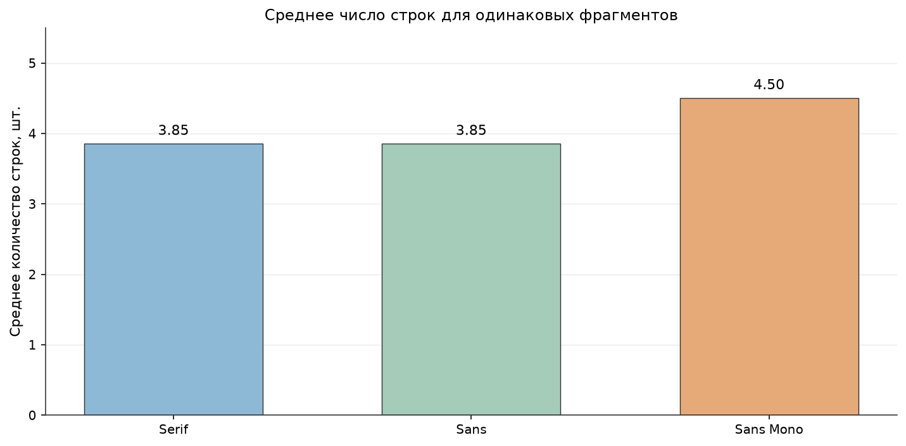

*Рисунок 00 · Среднее количество строк для одинаковых фрагментов в трёх шрифтах.*

[Первый спринт](Lab01_Sprint1.ipynb) · [Второй спринт](Lab01_Sprint2.ipynb) · [Отчёт со сворачиваемым кодом — спринт 1](reports/Sprint_1.md) · [Отчёт со сворачиваемым кодом — спринт 2](reports/Sprint_2.md)

---

<a id="contents"></a>

## Оглавление

**[1. Исходные данные и эксперимент](#data)**  
[Книги](#books) · [Условия измерения](#experiment) · [Пример наблюдения](#observation)

**[2. Случайная величина X — количество символов](#rv-chars)**  
[Описание](#chars-description) · [EDA](#chars-eda) · [Распределение](#chars-distribution)

**[3. Случайная величина Y — количество строк](#rv-lines)**  
[Описание](#lines-description) · [EDA](#lines-eda) · [Распределение](#lines-distribution)

**[4. Случайная величина Z — площадь букв](#rv-ink)**  
[Описание](#ink-description) · [EDA](#ink-eda) · [Распределение](#ink-distribution)

**[5. Зависимость и нормализация](#dependence)**  
[Корреляции](#dependence-test) · [Графики](#dependence-plots) · [Нормализация](#normalization)

**[6. Выборка и состоятельность оценок](#sampling)**  
[Способ отбора](#sampling-method) · [Сравнение статистик](#sampling-table) · [Рост выборки](#consistency)

**[7. Проверка гипотезы о шрифтах](#hypothesis)**  
[Гипотезы и критерий](#hypothesis-method) · [Результаты](#hypothesis-results) · [Вывод](#hypothesis-conclusion)

**[8. Дополнительный датасет КТвД — Iris](#extra)**

**[9. Итоги первого спринта](#sprint1-resume)** · [Таблица критериев](#sprint1-criteria)

**[10. Генератор случайного количества строк — спринт 2](#generator)**  
[Описание](#generator-description) · [Математическая база](#generator-math) · [Обратная функция](#inverse) · [Псевдонимы](#alias) · [Проверка генераторов](#generator-tests) · [Автотесты](#autotests) · [Выводы](#generator-resume) · [Таблица критериев](#generator-criteria)

**[11. Указатель рисунков и таблиц](#figure-index)**

**[12. Файлы проекта и запуск](#project)** · [Источники](#sources)

---

<a id="data"></a>

## 1. Исходные данные и эксперимент

<a id="books"></a>

### Книги

Использованы английские отрывки из первых глав трёх известных произведений. Тексты взяты из Project Gutenberg.

| Произведение | Автор | Фрагментов |
|:--|:--|--:|
| «Алиса в Стране чудес» | Льюис Кэрролл | 18 |
| «Гордость и предубеждение» | Джейн Остин | 18 |
| «Приключения Шерлока Холмса» | Артур Конан Дойл | 18 |
| **Всего** | | **54** |

Тексты разделены на небольшие фрагменты. Из каждой книги случайно выбрано по 18 фрагментов **без возвращения**, с фиксированным `seed = 2026`. Исходные тексты и выборка сохранены в [`data/texts/`](data/texts/) и [`data/fragments.csv`](data/fragments.csv).

**Случайный эксперимент:** из 54 сохранённых фрагментов выбирается один с вероятностью $1/54$. Для него измеряются три характеристики. При повторении опыта может быть выбран другой фрагмент. Для уже выбранного текста программа всегда считает одно и то же значение при одинаковых условиях набора.

<a id="experiment"></a>

### Условия измерения

Каждый фрагмент дополнительно набран тремя шрифтами. Так получено **162 измерения** — по три для каждого из 54 текстов.

| Параметр | Значение |
|:--|:--|
| Формат | А4 |
| Поля | 20 мм |
| Кегль | 12 pt |
| Межстрочный интервал | 1,4 |
| Доступная ширина строки | 170 мм |
| Перенос | по словам |
| Шрифты | DejaVu Serif, DejaVu Sans, DejaVu Sans Mono |
| Разрешение для измерения площади | 144 dpi |

**Таблица 01 · Что означают столбцы `layout.csv`**

<a id="table01"></a>

| Столбец | Значение |
|:--|:--|
| `id` | номер текстового фрагмента |
| `book` | название книги |
| `font` | использованный шрифт |
| `chars` | количество символов, включая пробелы, шт. |
| `words` | количество слов, шт. |
| `lines` | количество строк после переноса, шт. |
| `ink_cm2` | площадь закрашенных пикселей букв, см² |

<a id="observation"></a>

### Пример одного наблюдения

<a id="fig01"></a>

<p align="center">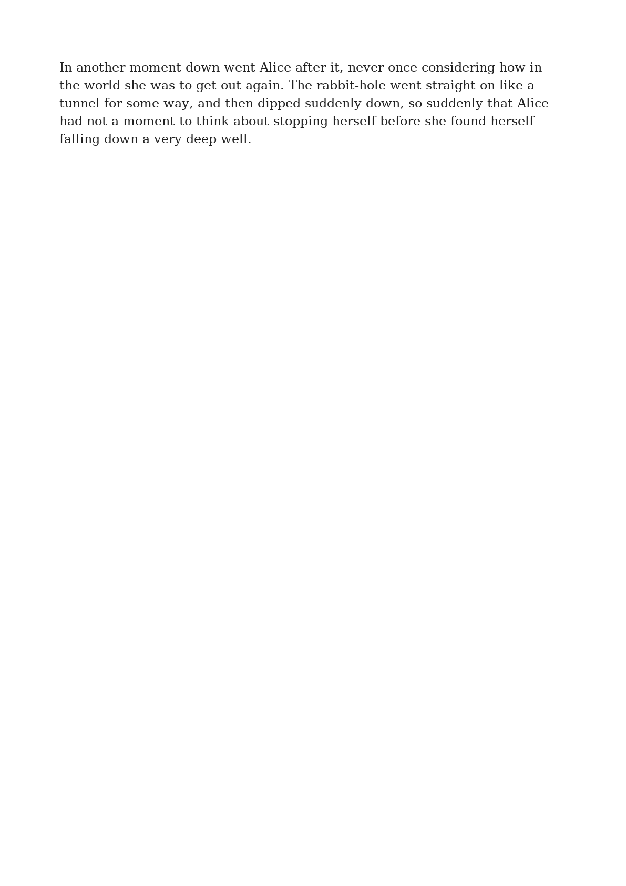</p>

*Рисунок 01 · Пример размещения фрагмента в DejaVu Serif.*

<a id="table02"></a>

**Таблица 02 · Один и тот же отрывок из «Алисы в Стране чудес»**

| Шрифт | Символов | Слов | Строк | Площадь букв, см² |
|:--|--:|--:|--:|--:|
| DejaVu Serif | 329 | 60 | 5 | 5,0469 |
| DejaVu Sans | 329 | 60 | 5 | 5,7457 |
| DejaVu Sans Mono | 329 | 60 | 6 | 5,7309 |

Измерение площади считается по пикселям изображения текста:

$$
S_{\mathrm{ink}}=\frac{1}{255}\sum_{i=1}^{P} I_i\left(\frac{2{,}54}{144}\right)^2,\qquad I_i\in[0,255].
$$

Здесь $I_i$ — интенсивность закрашивания пикселя, $144$ — разрешение в dpi. Площадь измеряет сами буквы, а не весь прямоугольник, занятый абзацем. Алгоритм находится в [`src/measurement.py`](src/measurement.py), подготовка данных — в [`src/build_data.py`](src/build_data.py).

<a id="rv-chars"></a>

## 2. Случайная величина X — количество символов

<a id="chars-description"></a>

### Description

$X$ — число символов в случайно выбранном фрагменте. Это **дискретная случайная величина**: она принимает целые значения. Число символов зависит от того, какой из 54 текстов попадётся.

<a id="chars-eda"></a>

### EDA

<a id="table03"></a>

**Таблица 03 · Статистики количества символов**

| Статистика | Значение |
|:--|--:|
| Число наблюдений | 54 |
| Среднее | 261,28 |
| Медиана | 231,5 |
| Стандартное отклонение | 124,12 |
| Дисперсия | 15 406,47 |
| Минимум / максимум | 95 / 733 |
| 25-й / 75-й процентили | 179 / 302 |

<a id="fig02"></a>

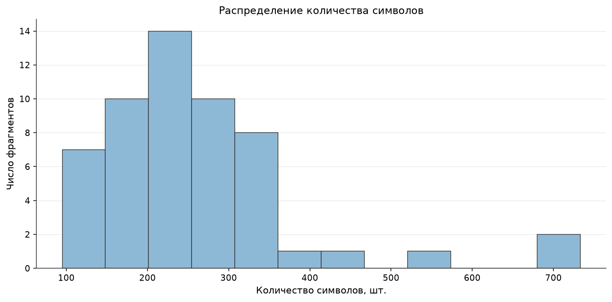

*Рисунок 02 · Количество символов в отрывках, шт.*

Большинство отрывков содержат примерно 150–350 символов. Есть несколько заметно более длинных.

<a id="chars-distribution"></a>

### Распределение

Вероятность каждого значения оценивается по частоте:

$$\widehat P(X=k)=\frac{n_k}{N},\qquad N=54.$$

Здесь $n_k$ — число фрагментов длиной $k$ символов. Для нашей конечной таблицы используем **эмпирическое распределение**, без предположения о нормальности.

<a id="rv-lines"></a>

## 3. Случайная величина Y — количество строк

<a id="lines-description"></a>

### Description

$Y$ — число строк выбранного фрагмента при наборе шрифтом **DejaVu Serif**. Это дискретная случайная величина. Количество строк зависит не только от длины, но и от слов в тексте и правил переноса.

<a id="lines-eda"></a>

### EDA

<a id="table04"></a>

**Таблица 04 · Статистики количества строк**

| Статистика | Значение |
|:--|--:|
| Число наблюдений | 54 |
| Среднее | 3,85 строки |
| Медиана | 3 строки |
| Стандартное отклонение | 1,68 строки |
| Дисперсия | 2,81 строки² |
| Минимум / максимум | 2 / 10 строк |

<a id="fig03"></a>

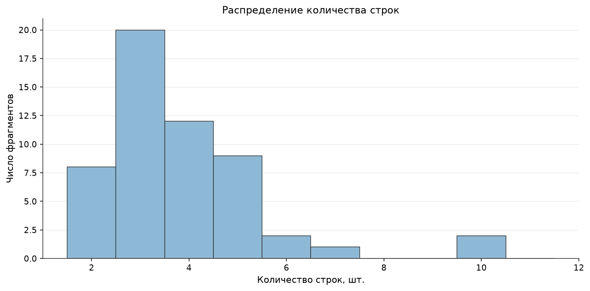

*Рисунок 03 · Число строк в DejaVu Serif.*

Чаще всего фрагмент занимает **три строки**.

<a id="lines-distribution"></a>

### Распределение

<a id="table05"></a>

**Таблица 05 · Эмпирическое распределение Y**

| Строк | 2 | 3 | 4 | 5 | 6 | 7 | 10 |
|:--|--:|--:|--:|--:|--:|--:|--:|
| Фрагментов | 8 | 20 | 12 | 9 | 2 | 1 | 2 |
| Вероятность | 0,1481 | 0,3704 | 0,2222 | 0,1667 | 0,0370 | 0,0185 | 0,0370 |

$$\widehat P(Y=k)=\frac{n_k}{54},\qquad\sum_k\widehat P(Y=k)=1.$$

Это распределение понадобится во втором спринте для генерации случайного количества строк.

<a id="rv-ink"></a>

## 4. Случайная величина Z — площадь букв

<a id="ink-description"></a>

### Description

$Z$ — суммарная площадь закрашенных пикселей текста в **DejaVu Serif**, см². Она измеряется по изображению, поэтому в таблице значения записаны с ограниченной точностью. В отличие от числа строк, это измеряемая, а не целочисленная величина.

<a id="ink-eda"></a>

### EDA

<a id="table06"></a>

**Таблица 06 · Статистики площади текста**

| Статистика | Значение |
|:--|--:|
| Число наблюдений | 54 |
| Среднее | 3,87 см² |
| Медиана | 3,47 см² |
| Стандартное отклонение | 1,84 см² |
| Дисперсия | 3,38 см⁴ |
| Минимум / максимум | 1,34 / 10,62 см² |

<a id="fig04"></a>

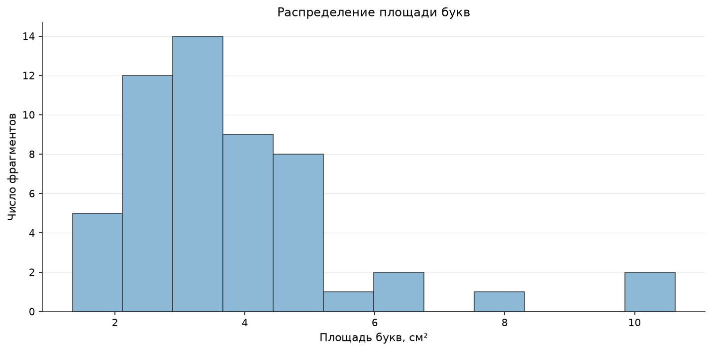

*Рисунок 04 · Суммарная закрашенная площадь текста, см².*

Площадь растёт вместе с длиной отрывка, но зависит и от формы букв. Несколько длинных текстов дают правый хвост распределения.

<a id="ink-distribution"></a>

### Распределение

Для площади используем эмпирическую функцию распределения:

$$\widehat F_Z(z)=\frac{1}{N}\sum_{i=1}^{N}\mathbf 1(Z_i\le z).$$

Она показывает долю фрагментов, площадь которых не превышает $z$. Заранее считать распределение нормальным оснований нет.

<a id="dependence"></a>

## 5. Зависимость и нормализация

<a id="dependence-test"></a>

### Корреляция

Для проверки зависимости $X$, $Y$ и $Z$ используется коэффициент Спирмена. Он сравнивает ранги значений и подходит, когда связь не обязательно линейная.

<a id="table07"></a>

**Таблица 07 · Корреляция Спирмена по 54 фрагментам**

| Пара величин | $\rho$ |
|:--|--:|
| Символы — строки ($X$, $Y$) | 0,964 |
| Символы — площадь ($X$, $Z$) | 0,996 |
| Строки — площадь ($Y$, $Z$) | 0,965 |

<a id="dependence-plots"></a>

### Графики

<a id="fig05"></a>

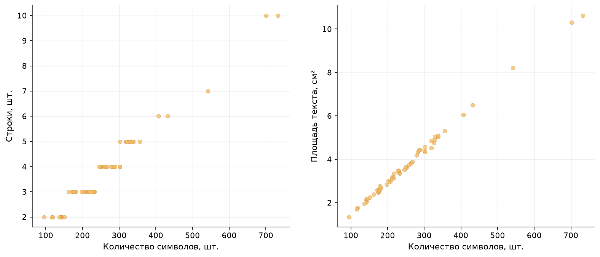

*Рисунок 05 · Количество символов и число строк; количество символов и площадь.*

Все три величины сильно и положительно связаны. **Независимыми их считать нельзя.** Корреляция не доказывает причинно-следственную связь сама по себе.

<a id="normalization"></a>

### Нормализация

У трёх признаков разные единицы измерения. Для сопоставления их шкал использована стандартизация (z-оценка):

$$z_i=\frac{x_i-\overline x}{s},\qquad s^2=\frac{1}{N-1}\sum_{i=1}^{N}(x_i-\overline x)^2.$$

После этого среднее стандартизированных значений равно нулю, а выборочное стандартное отклонение — единице. **Стандартизация не превращает ненормальное распределение в нормальное.**

<a id="fig06"></a>

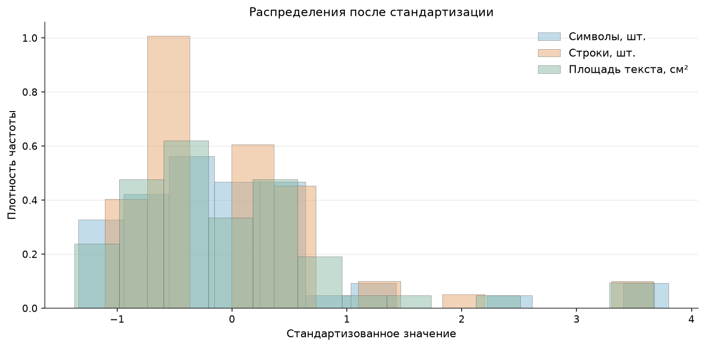

*Рисунок 06 · Сопоставление трёх величин на одной шкале.*

<a id="sampling"></a>

## 6. Выборка и состоятельность оценок

<a id="sampling-method"></a>

### Способ отбора

Генеральной совокупностью в этом исследовании считаем **54 сохранённых фрагмента**. Для сравнения отбираем 20 из них **без возвращения**: в одной выборке текст не повторяется.

Оценка среднего по выборке:

$$\overline X_n=\frac{1}{n}\sum_{i=1}^{n}X_i.$$

Для простого случайного отбора без возвращения из конечной совокупности:

$$\operatorname{Var}(\overline X_n)=\frac{S^2}{n}\left(1-\frac{n}{N}\right),\qquad N=54.$$

Здесь $S^2$ — дисперсия конечной совокупности с делителем $N-1$. Множитель $1-n/N$ учитывает отсутствие повторов.

<a id="sampling-table"></a>

### Сравнение статистик

<a id="table08"></a>

**Таблица 08 · Вся совокупность и выборка из 20 фрагментов**

| Величина | Среднее по 54 | Среднее по 20 | Ст. откл. по 54 | Ст. откл. по 20 |
|:--|--:|--:|--:|--:|
| Число символов, шт. | 261,28 | 248,90 | 124,12 | 72,52 |
| Число строк, шт. | 3,85 | 3,70 | 1,68 | 0,98 |
| Площадь букв, см² | 3,87 | 3,69 | 1,84 | 1,09 |

<a id="consistency"></a>

### Состоятельность оценок

Для размеров выборки $6$, $12$, $20$, $35$, $50$ и $54$ случайный отбор повторялся по 400 раз. Сравнивали средние с показателями всех 54 фрагментов.

<a id="fig07"></a>

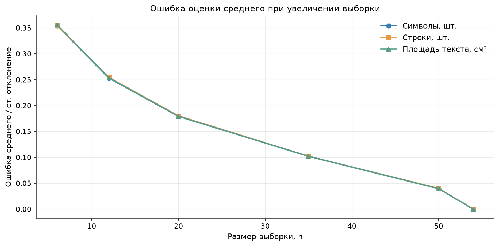

*Рисунок 07 · Ошибка оценки среднего относительно стандартного отклонения.*

<a id="table09"></a>

**Таблица 09 · Средняя ошибка оценки для разных $n$ (приближённо)**

| $n$ | 6 | 12 | 20 | 35 | 50 | 54 |
|--:|--:|--:|--:|--:|--:|--:|
| Ошибка для числа строк | 0,355 | 0,254 | 0,180 | 0,102 | 0,040 | 0 |

При росте $n$ ошибка в эксперименте уменьшается. При $n=54$ она равна нулю, поскольку берётся вся таблица. Это иллюстрация поведения оценки для данной конечной совокупности, **не доказательство для всех возможных текстов**.

<a id="hypothesis"></a>

## 7. Проверка гипотезы: влияет ли шрифт на число строк?

<a id="hypothesis-method"></a>

### Гипотезы и критерий

Сравниваем **одни и те же 54 текста** в двух шрифтах. Для каждого считаем разность:

$$D_i=Y_{i,\,\mathrm{Mono}}-Y_{i,\,\mathrm{Serif}}.$$

- $H_0$: среди ненулевых разностей положительные и отрицательные знаки равновероятны.
- $H_1$: положительные разности встречаются чаще.

Применяем односторонний **критерий знаков** с уровнем значимости $\alpha=0{,}05$. Нулевые разности при проверке исключаются.

<a id="hypothesis-results"></a>

### Результаты

<a id="table10"></a>

**Таблица 10 · Сравнение набора одного текста разными шрифтами**

| Показатель | Значение |
|:--|--:|
| Среднее число строк, DejaVu Serif | 3,85 |
| Среднее число строк, DejaVu Sans | 3,85 |
| Среднее число строк, DejaVu Sans Mono | 4,54 |
| Разность Mono − Serif в среднем | +0,69 строки |
| Mono больше / меньше / одинаково | 35 / 0 / 19 |
| $p$-value | $2{,}91\cdot10^{-11}$ |

<a id="fig08"></a>

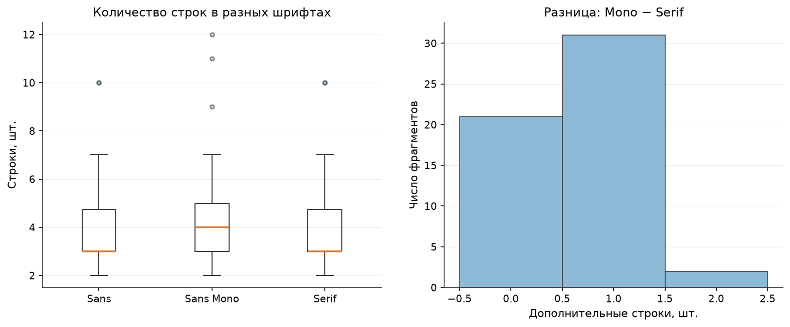

*Рисунок 08 · Распределения числа строк и разница Mono − Serif.*

<a id="hypothesis-conclusion"></a>

### Вывод

$p<0{,}05$, поэтому $H_0$ отвергается. В нашей подборке **DejaVu Sans Mono чаще требует больше строк**, чем DejaVu Serif. Результат относится к выбранным текстам и настройкам набора.

<a id="extra"></a>

## 8. Дополнительный датасет КТвД — Iris

Это отдельное исследование на другом наборе данных. В файле [`data/iris.csv`](data/iris.csv) находятся измерения **150 цветков**. Рассмотрены длина и ширина лепестка в сантиметрах.

<a id="table11"></a>

**Таблица 11 · Статистики двух величин Iris**

| Величина | Среднее, см | Медиана, см | Ст. отклонение, см |
|:--|--:|--:|--:|
| Длина лепестка | 3,758 | 4,35 | 1,765 |
| Ширина лепестка | 1,199 | 1,30 | 0,762 |

<a id="fig09"></a>

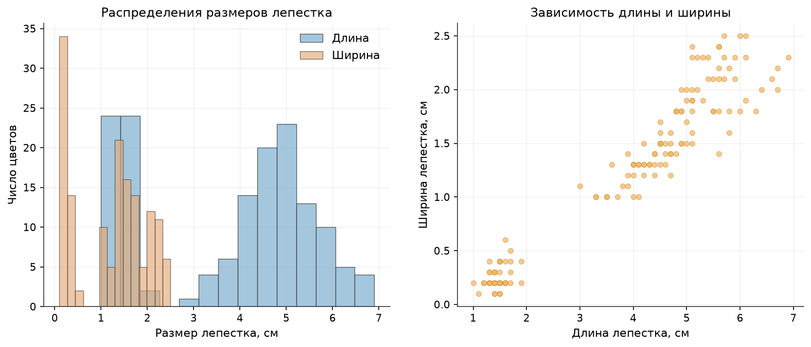

*Рисунок 09 · Распределения двух признаков и их взаимосвязь.*

Коэффициент Спирмена $\rho=0{,}938$; $p\approx8{,}16\cdot10^{-70}$. Связь сильная и положительная. При этом данные содержат три вида ирисов, поэтому часть зависимости может быть связана с различиями между видами.

<a id="sprint1-resume"></a>

## 9. Итоги первого спринта

1. Количество символов, число строк и площадь букв тесно связаны между собой.
2. Для случайной выборки средние приближаются к значениям всей изучаемой таблицы по мере роста объёма выборки.
3. Один и тот же фрагмент текста чаще занимает больше строк в DejaVu Sans Mono, чем в DejaVu Serif ($p<0{,}05$).
4. Результаты относятся к этой подборке текстов и шрифтов, а не ко всем книгам.

<a id="sprint1-criteria"></a>

### cat_mark_table · Спринт 1

| cat_id | notebook_link | coeff | comment |
|:--|:--|:--:|:--|
| Случайные величины | [X](#rv-chars), [Y](#rv-lines), [Z](#rv-ink) | — | Три величины и распределения |
| EDA | [§2–4](#rv-chars) | — | Таблицы и графики |
| Зависимость | [§5](#dependence) | — | Коэффициент Спирмена |
| Нормализация | [§5](#normalization) | — | z-оценка |
| Выборка и оценки | [§6](#sampling) | — | Без возвращения, повторный отбор |
| Гипотеза | [§7](#hypothesis) | — | Критерий знаков |
| Дополнительный датасет КТвД | [§8](#extra) | — | Iris |

Точные коэффициенты преподаватель не предоставил, поэтому в столбце `coeff` стоят прочерки.

[↑ К оглавлению](#contents)

---

<a id="generator"></a>

## 10. Генератор случайного количества строк · Спринт 2

<a id="generator-description"></a>

### Description

В качестве основы выбрана случайная величина **Y** из первого спринта: число строк одного из 54 фрагментов в **DejaVu Serif**. Генератор выдаёт возможные значения числа строк с частотами, близкими к исходным. **Новый текст он не создаёт.**

<a id="generator-math"></a>

### Математическая база

Из 54 наблюдений получены вероятности $p_k=n_k/54$ (таблица 05). Используем два способа генерации из этого дискретного распределения: метод обратной функции и метод псевдонимов.

<a id="inverse"></a>

### Метод обратной функции

Для каждого значения считаем накопленную вероятность:

$$F(k)=P(Y\le k)=\sum_{y_i\le k}p_i.$$

Генерируем $U\sim U[0,1)$ и выбираем первое $k$, для которого $F(k)>U$:

$$Y=F^{-1}(U)=\min\{k:F(k)>U\}.$$

Каждому значению отведён участок единичного отрезка длиной $p_k$. Равномерное число попадает в этот участок с нужной вероятностью.

<a id="table12"></a>

**Таблица 12 · Накопленные вероятности**

| $Y$ | 2 | 3 | 4 | 5 | 6 | 7 | 10 |
|:--|--:|--:|--:|--:|--:|--:|--:|
| $F(Y)$ | 0,1481 | 0,5185 | 0,7407 | 0,9074 | 0,9444 | 0,9630 | 1,0000 |

<details>
<summary><strong>Показать код метода обратной функции</strong></summary>

```python
import numpy as np

def inverse_cdf(values, probabilities, size, seed=42):
    rng = np.random.default_rng(seed)
    borders = np.cumsum(probabilities)
    borders[-1] = 1.0
    indexes = np.searchsorted(borders, rng.random(size), side="right")
    return np.asarray(values)[indexes]
```

Полная реализация с проверкой входных данных: [`src/sprint2_generators.py`](src/sprint2_generators.py).
</details>

<a id="alias"></a>

### Дополнительный метод — псевдонимы

В методе Уокера — Воуза заранее строится таблица из $m$ столбцов. В каждом столбце есть порог $q_i$ и запасной индекс `alias[i]`.

1. Равновероятно выбирается столбец $i$.
2. Генерируется $V\sim U[0,1)$.
3. Если $V<q_i$, возвращается основное значение, иначе — псевдоним.

Вероятность получить $y_j$:

$$P(Y=y_j)=\frac{1}{m}\left(q_j+\sum_{i:\,\mathrm{alias}(i)=j}(1-q_i)\right)=p_j.$$

Подготовка таблицы занимает $O(m)$, а получение одного нового значения после подготовки — $O(1)$. Для метода обратной функции в этой реализации поиск по массиву границ занимает $O(\log m)$.

<details>
<summary><strong>Показать код выбора по таблице псевдонимов</strong></summary>

```python
def alias_sample(values, probabilities, size, seed=42):
    values, p = _check(values, probabilities)
    cut, alias = make_alias_table(p)
    rng = np.random.default_rng(seed)
    columns = rng.integers(0, len(values), size=size)
    coins = rng.random(size)
    indexes = np.where(coins < cut[columns], columns, alias[columns])
    return values[indexes]
```

Функции `_check` и `make_alias_table` находятся в [`src/sprint2_generators.py`](src/sprint2_generators.py).
</details>

<a id="generator-tests"></a>

### Tests · Сравнение с исходными данными

Для каждого алгоритма сгенерировано по **15 000 значений** с фиксированным `seed`. Сравниваются среднее, медиана, разброс и частоты.

<a id="fig10"></a>

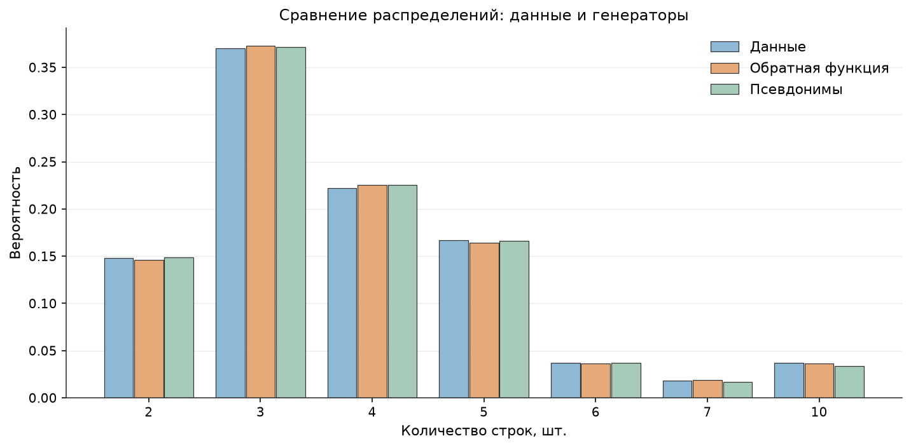

*Рисунок 10 · Частоты количества строк: исходная таблица, обратная функция и псевдонимы.*

<a id="table13"></a>

**Таблица 13 · Основные статистики**

| Метрика | Данные | Обратная функция | Псевдонимы |
|:--|--:|--:|--:|
| Среднее, строк | 3,8519 | 3,8443 | 3,8239 |
| Стандартное отклонение | 1,6601 | 1,6469 | 1,6189 |
| Медиана | 3 | 3 | 3 |
| Доля с 5+ строками | 0,2593 | 0,2555 | 0,2537 |

Для сравнения частот использован критерий $\chi^2$:

$$\chi^2=\sum_k\frac{(O_k-E_k)^2}{E_k},\qquad E_k=n\,p_k.$$

<a id="table14"></a>

**Таблица 14 · Сравнение частот с исходным распределением**

| Метод | $\chi^2$ | $p$-value | Расстояние TV |
|:--|--:|--:|--:|
| Обратная функция | 2,2379 | 0,8966 | 0,00576 |
| Псевдонимы | 7,9099 | 0,2448 | 0,00553 |

Оба $p$-value больше 0,05, поэтому значимых отличий от **заданных эмпирических вероятностей** критерий не обнаружил. Это не означает, что данные точно описывают все книги.

<a id="autotests"></a>

### Автотесты

Проверены допустимые значения, повторяемость с одним `seed`, совпадение частот, неверные вероятности и случай единственного возможного значения.

<details>
<summary><strong>Показать команду проверки</strong></summary>

```bash
python -m pytest -q
```

В подготовленной версии проекта: **13 пройденных тестов** (2 по измерению и 11 для генератора). Исходные файлы: [`tests/`](tests/).
</details>

<a id="generator-resume"></a>

### Resume · Выводы по генератору

1. Оба алгоритма дают распределение количества строк, близкое к наблюдавшимся частотам.
2. Медиана совпала (3 строки), средние двух генераторов близки к исходному среднему.
3. Метод обратной функции проще, а метод псевдонимов удобнее, когда требуется много случайных значений.

<a id="generator-criteria"></a>

### cat_mark_table · Спринт 2

| cat_id | notebook_link | coeff | comment |
|:--|:--|:--:|:--|
| Описание величины | [Description](#generator-description) | — | Дискретная величина Y |
| Математическая база | [Math](#generator-math) | — | Эмпирическое распределение |
| Основной алгоритм | [Обратная функция](#inverse) | — | Код и формула |
| Дополнительный алгоритм | [Псевдонимы](#alias) | — | Таблица Уокера — Воуза |
| Сравнение данных | [Tests](#generator-tests) | — | Метрики и критерий $\chi^2$ |
| Автотесты | [pytest](#autotests) | — | Проверки обоих методов |
| Литература | [Источники](#sources) | — | Книги и статьи |

[↑ К оглавлению](#contents)

---

<a id="figure-index"></a>

## 11. Указатель рисунков и таблиц

**Рисунки**

- [Рисунок 00 · Сравнение среднего количества строк по шрифтам](#fig00)
- [Рисунок 01 · Пример размещения текста на листе А4](#fig01)
- [Рисунок 02 · Распределение количества символов](#fig02)
- [Рисунок 03 · Распределение количества строк](#fig03)
- [Рисунок 04 · Распределение площади букв](#fig04)
- [Рисунок 05 · Связь длины фрагмента с числом строк и площадью](#fig05)
- [Рисунок 06 · Стандартизированные характеристики](#fig06)
- [Рисунок 07 · Изменение ошибки при увеличении выборки](#fig07)
- [Рисунок 08 · Сравнение трёх шрифтов](#fig08)
- [Рисунок 09 · Дополнительный датасет Iris](#fig09)
- [Рисунок 10 · Сравнение исходных данных и генераторов](#fig10)

**Таблицы**

- [Таблица 01 · Описание столбцов](#table01)
- [Таблица 02 · Пример измерений для одного фрагмента](#table02)
- [Таблица 03 · Статистики количества символов](#table03)
- [Таблица 04 · Статистики количества строк](#table04)
- [Таблица 05 · Эмпирическое распределение числа строк](#table05)
- [Таблица 06 · Статистики площади](#table06)
- [Таблица 07 · Корреляция](#table07)
- [Таблица 08 · Сравнение совокупности и выборки](#table08)
- [Таблица 09 · Ошибка при разных размерах выборки](#table09)
- [Таблица 10 · Проверка гипотезы](#table10)
- [Таблица 11 · Дополнительный датасет](#table11)
- [Таблица 12 · Накопленные вероятности](#table12)
- [Таблица 13 · Статистики генераторов](#table13)
- [Таблица 14 · Критерий $\chi^2$](#table14)

[↑ К оглавлению](#contents)

---

<a id="project"></a>

## 12. Файлы проекта и запуск

```text
Lab1/
├── Lab01_Sprint1.ipynb
├── Lab01_Sprint2.ipynb
├── README.md
├── data/               # фрагменты книг и CSV
├── figures/            # графики и пример страницы
├── reports/            # отчёты со сворачиваемым кодом
├── src/                # измерение и генерация
├── tests/              # автотесты
└── requirements.txt
```

Для просмотра можно открыть README прямо на GitHub. Для проверки вычислений — ноутбуки в PyCharm/Jupyter. Полный код есть в `.ipynb` и в файлах `src/`; в Markdown-отчётах код раскрывается по нажатию «Показать код».

<details>
<summary><strong>Показать команды установки и запуска</strong></summary>

```bash
python -m pip install -r requirements.txt
python -m pytest -q
```

Повторное построение датасета (необязательно):

```bash
python -m src.build_data
```

При пересоздании измерений на другом компьютере результат может немного отличаться из-за установленных версий шрифтов.
</details>

<a id="sources"></a>

### Источники и ограничения

**Книги и данные**

1. Льюис Кэрролл — [*Alice's Adventures in Wonderland*](https://www.gutenberg.org/ebooks/11), Project Gutenberg.
2. Джейн Остин — [*Pride and Prejudice*](https://www.gutenberg.org/ebooks/1342), Project Gutenberg.
3. Артур Конан Дойл — [*The Adventures of Sherlock Holmes*](https://www.gutenberg.org/ebooks/1661), Project Gutenberg.
4. [Iris Dataset](https://archive.ics.uci.edu/dataset/53/iris), UCI Machine Learning Repository.

**Алгоритмы генерации**

5. L. Devroye, *Non-Uniform Random Variate Generation* (1986) — [книга](https://luc.devroye.org/books-luc.html).
6. A. J. Walker, *An Efficient Method for Generating Discrete Random Variables with General Distributions* (1977) — [DOI](https://doi.org/10.1145/355744.355749).
7. M. D. Vose, *A Linear Algorithm for Generating Random Numbers with a Given Distribution* (1991) — [DOI](https://doi.org/10.1109/32.92917).

**Ограничения:** использованы 54 коротких фрагмента из первых глав и три конкретных шрифта. Выводы не относятся автоматически ко всем книгам, типам шрифтов и способам вёрстки.

[↑ К оглавлению](#contents)