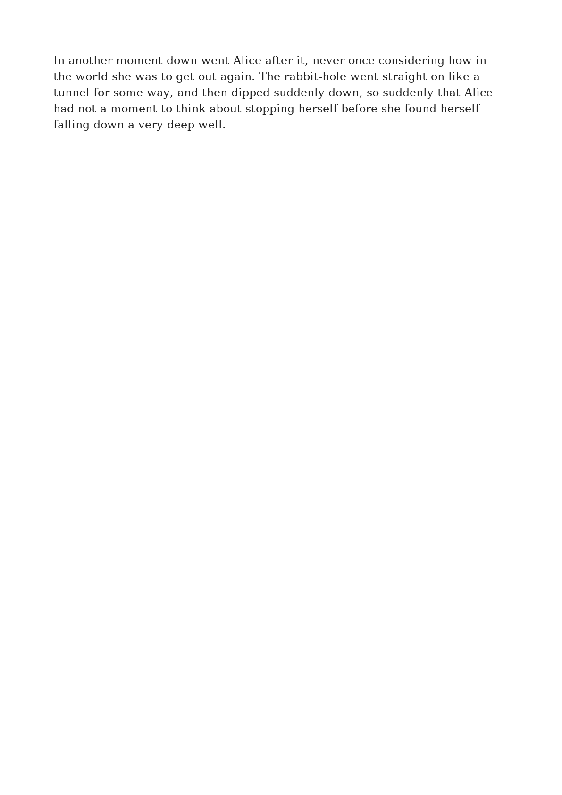
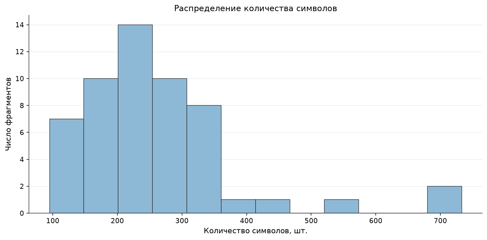
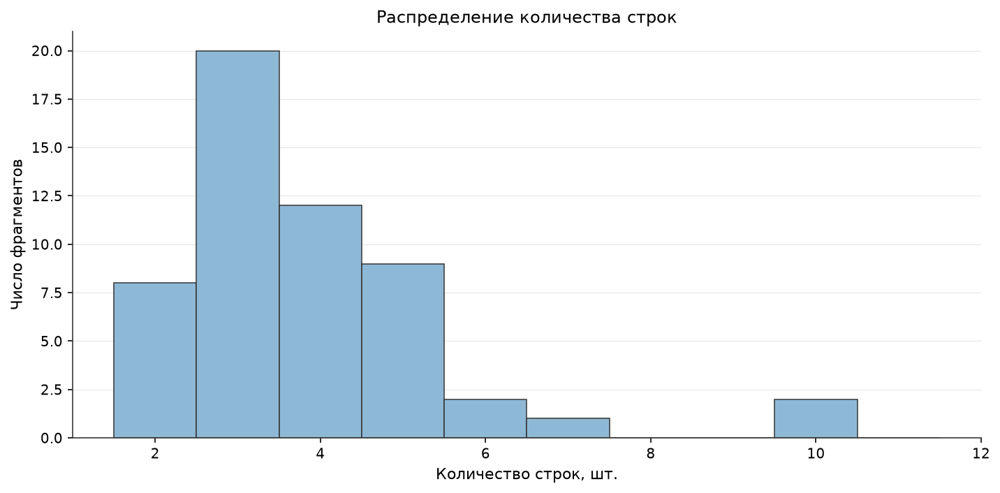
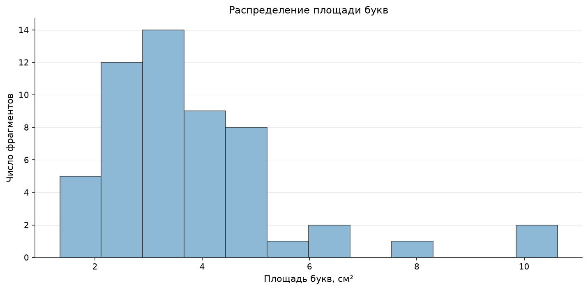
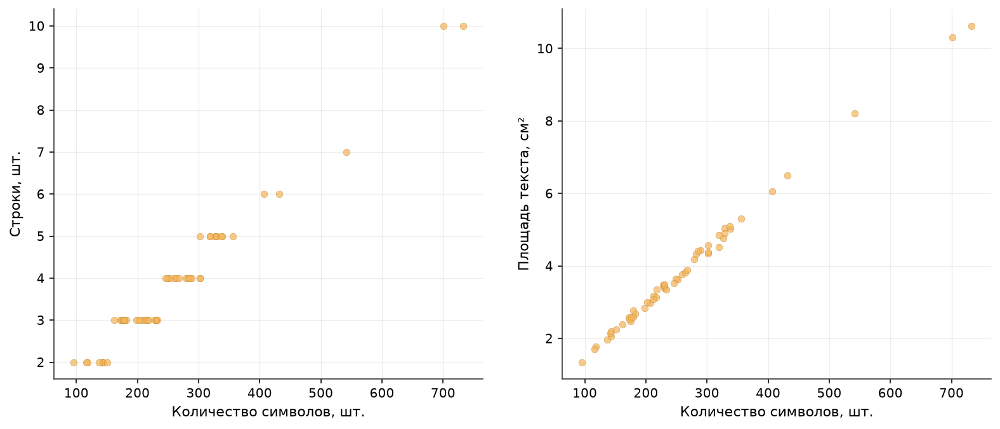
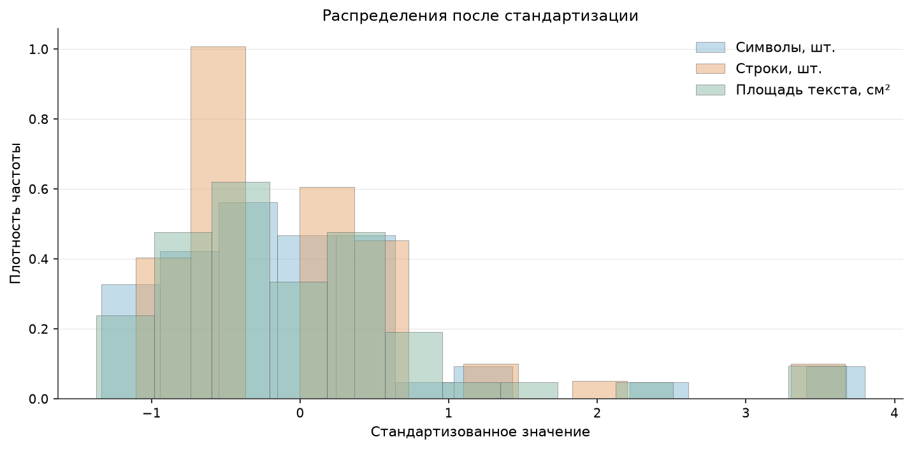
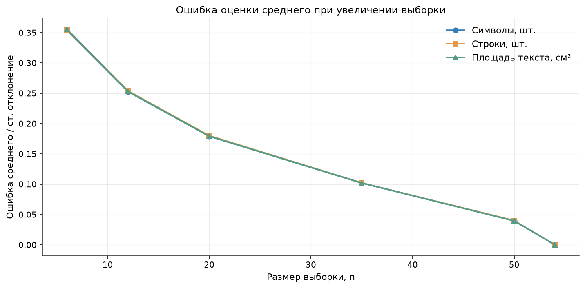
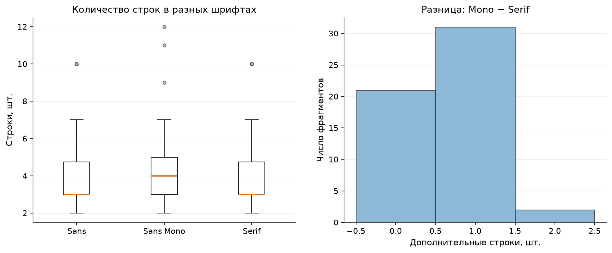
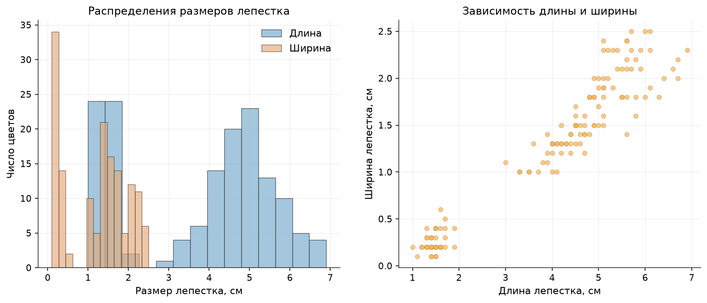

<!-- Результаты и графики · код можно раскрывать по нажатию -->

# Лабораторная работа № 01 — прикладная статистика
## Sprint 1. Как шрифты влияют на размещение текста

**Цель:** сравнить, сколько места занимает один и тот же текст в разных шрифтах.

<a id="data"></a>
## 1. Данные и эксперимент

Использованы отрывки из первых глав трёх книг: «Алиса в Стране чудес», «Гордость и предубеждение», «Приключения Шерлока Холмса». Тексты взяты из Project Gutenberg, очищены от оформления и разделены на короткие фрагменты. Из каждого произведения случайно выбрано 18 фрагментов, всего 54.

**Эксперимент:** выбираем один из 54 фрагментов с равной вероятностью $1/54$ и измеряем его в шрифте **DejaVu Serif**. При повторении эксперимента может попасться другой текст, поэтому результаты случайны. После выбора конкретного текста измерение уже детерминированно.

Для сравнения шрифтов каждый фрагмент дополнительно набран в **DejaVu Sans** и **DejaVu Sans Mono**. Условия одинаковые: лист А4, поля 20 мм, кегль 12 pt, межстрочный интервал 1,4. Перенос — по словам, без выравнивания по ширине и переносов внутри слов.

Таблицы `data/fragments.csv` и `data/layout.csv` содержат соответственно исходные фрагменты и результаты измерений. Алгоритм — в `src/build_data.py` и `src/measurement.py`.

<details>
<summary>Показать код</summary>

```python
import numpy as np
import pandas as pd
import matplotlib.pyplot as plt
from scipy import stats
from IPython.display import display, Image

plt.rcParams.update({
    "figure.figsize": (11.8, 5.5),
    "figure.dpi": 145,
    "figure.facecolor": "white",
    "axes.facecolor": "white",
    "savefig.facecolor": "white",
    "savefig.bbox": "tight",
    "font.family": "DejaVu Sans",
    "font.size": 11,
    "axes.titlesize": 15,
    "axes.titleweight": "semibold",
    "axes.labelsize": 12,
    "axes.labelcolor": "#263743",
    "text.color": "#263743",
    "xtick.color": "#5A6A75",
    "ytick.color": "#5A6A75",
    "axes.edgecolor": "#D7E0E5",
    "axes.spines.top": False,
    "axes.spines.right": False,
    "axes.grid": True,
    "axes.grid.axis": "y",
    "axes.axisbelow": True,
    "grid.color": "#E3E9ED",
    "grid.alpha": 0.75,
    "legend.frameon": False,
})

cols = {"chars": "Символы, шт.", "lines": "Строки, шт.", "ink_cm2": "Площадь текста, см²"}

texts = pd.read_csv("data/fragments.csv")
layout = pd.read_csv("data/layout.csv")
base = layout[layout.font == "DejaVu Serif"].reset_index(drop=True)
print("Фрагментов:", len(texts), "| Измерений:", len(layout))
display(texts.assign(text=texts.text.str.slice(0, 85) + "…")[["id", "book", "text"]].head(4))
```

</details>

```text
Фрагментов: 54 | Измерений: 162
```

|   | id | book | text |
| --- | --- | --- | --- |
| 0 | alice-01 | Алиса в Стране чудес | In another moment down went Alice after it, ne... |
| 1 | alice-02 | Алиса в Стране чудес | Oh, how I wish I could shut up like a telescop... |
| 2 | alice-03 | Алиса в Стране чудес | Alice was not a bit hurt, and she jumped up on... |
| 3 | alice-04 | Алиса в Стране чудес | She felt that she was dozing off, and had just... |

### Как получено одно наблюдение

`chars` — число символов (включая пробелы); `words` — число слов; `lines` — число строк после переноса; `ink_cm2` — суммарная площадь закрашенных пикселей букв в см². Для площади текст рисуется при 144 dpi, затем интенсивности пикселей переводятся в см².

$$S_{\text{ink}} = \frac{1}{255}\sum_{i=1}^{P} I_i\left(\frac{2.54}{144}\right)^2, \quad I_i\in[0,255].$$

<details>
<summary>Показать код</summary>

```python
from src.measurement import load_font, measure

text = texts.loc[0, "text"]
print(text[:260] + ("…" if len(text) > 260 else ""))
for name in ["DejaVu Serif", "DejaVu Sans Mono"]:
    print(name, "→", measure(text, load_font(name)))
display(layout[layout.id == texts.loc[0, "id"]])
display(Image(filename="figures/example_a4.png", width=390))
```

</details>

```text
In another moment down went Alice after it, never once considering how in the world she was to get out again. The rabbit-hole went straight on like a tunnel for some way, and then dipped suddenly down, so suddenly that Alice had not a moment to think about sto…
DejaVu Serif → (5, 5.0469)
DejaVu Sans Mono → (6, 5.7309)
```

|   | id | book | font | chars | words | lines | ink_cm2 |
| --- | --- | --- | --- | --- | --- | --- | --- |
| 0 | alice-01 | Алиса в Стране чудес | DejaVu Serif | 329 | 60 | 5 | 5.0469 |
| 1 | alice-01 | Алиса в Стране чудес | DejaVu Sans | 329 | 60 | 5 | 5.7457 |
| 2 | alice-01 | Алиса в Стране чудес | DejaVu Sans Mono | 329 | 60 | 6 | 5.7309 |



<a id="rv1"></a>
## 2. Random Variable 01 — количество символов $X$
### Description

$X$ — число символов в случайно выбранном фрагменте. Это дискретная величина.

### EDA & Distribution

Эмпирическая вероятность: $\hat P(X=k)=n_k/N$, где $n_k$ — число фрагментов длины $k$.

<details>
<summary>Показать код</summary>

```python
display(base["chars"].describe().round(2).to_frame("Символы"))
ax = base.chars.hist(bins=12, color="#426B82", edgecolor="white")
ax.set(xlabel="Количество символов, шт.", ylabel="Количество фрагментов")
ax.set_title("Распределение длины фрагментов", loc="left", pad=16)
plt.tight_layout()
plt.show()
```

</details>

|   | Символы |
| --- | --- |
| count | 54.00 |
| mean | 261.28 |
| std | 124.12 |
| min | 95.00 |
| 25% | 179.00 |
| 50% | 231.50 |
| 75% | 302.00 |
| max | 733.00 |



<a id="rv2"></a>
## 3. Random Variable 02 — количество строк $Y$
### Description

$Y$ — число строк, которое занимает выбранный фрагмент в DejaVu Serif. Результат целочисленный.

### EDA & Distribution

Вероятность $\hat P(Y=k)$ оцениваем долей фрагментов, занявших $k$ строк.

<details>
<summary>Показать код</summary>

```python
display(base["lines"].describe().round(2).to_frame("Строки"))
ax = base.lines.hist(bins=np.arange(1.5, base.lines.max()+1.6), color="#426B82", edgecolor="white")
ax.set(xlabel="Количество строк, шт.", ylabel="Количество фрагментов")
ax.set_title("Распределение числа строк · DejaVu Serif", loc="left", pad=16)
plt.tight_layout()
plt.show()
```

</details>

|   | Строки |
| --- | --- |
| count | 54.00 |
| mean | 3.85 |
| std | 1.68 |
| min | 2.00 |
| 25% | 3.00 |
| 50% | 3.00 |
| 75% | 4.75 |
| max | 10.00 |



<a id="rv3"></a>
## 4. Random Variable 03 — площадь текста $Z$
### Description

$Z$ — суммарная площадь закрашенных пикселей выбранного фрагмента. Значения измеряются в см², с точностью до разрешения изображения.

### EDA & Distribution

Используем эмпирическую функцию распределения:

$$\hat F_Z(z)=\frac1N\sum_{i=1}^N\mathbf 1(Z_i\le z).$$

Не предполагаем заранее, что распределение нормальное.

<details>
<summary>Показать код</summary>

```python
display(base["ink_cm2"].describe().round(2).to_frame("Площадь, см²"))
ax = base.ink_cm2.hist(bins=12, color="#426B82", edgecolor="white")
ax.set(xlabel="Площадь закрашенных пикселей, см²", ylabel="Количество фрагментов")
ax.set_title("Распределение площади текста", loc="left", pad=16)
plt.tight_layout()
plt.show()
```

</details>

|   | Площадь, см² |
| --- | --- |
| count | 54.00 |
| mean | 3.87 |
| std | 1.84 |
| min | 1.34 |
| 25% | 2.62 |
| 50% | 3.47 |
| 75% | 4.50 |
| max | 10.62 |



**Вывод.** Размеры фрагментов различаются. Число строк меняется скачками, а площадь текста зависит от формы и количества букв.

<a id="depend"></a>
## 5. Зависимость и нормализация

Проверим связь между $X$, $Y$ и $Z$ по коэффициенту Спирмена. Он показывает, насколько согласованно меняются значения, но не доказывает причинную связь.

<details>
<summary>Показать код</summary>

```python
print(base[list(cols)].corr(method="spearman").round(2))
rho, p_rho = stats.spearmanr(base.chars, base.lines)
print(f"X и Y: rho = {rho:.3f}; p = {p_rho:.3g}")
fig, axs = plt.subplots(1, 2, figsize=(14, 5.6))
for ax, col, title in zip(axs, ["lines", "ink_cm2"], ["Строки, шт.", "Площадь текста, см²"]):
    ax.scatter(base.chars, base[col], s=24, alpha=0.7, color="#426B82")
    ax.set_xlabel("Символы, шт.")
    ax.set_ylabel(title)
    ax.set_title("Символы и строки" if col == "lines" else "Символы и площадь", loc="left", pad=12)
fig.tight_layout()
plt.show()
```

</details>

```text
chars  lines  ink_cm2
chars     1.00   0.96     1.00
lines     0.96   1.00     0.96
ink_cm2   1.00   0.96     1.00
X и Y: rho = 0.964; p = 1.35e-31
```



Длина текста ожидаемо связана с числом строк и площадью. Чтобы сравнить величины с разными единицами измерения, используем $z$-оценку:

$$z_i = \frac{x_i-\overline x}{s}, \quad s^2=\frac{1}{N-1}\sum_{i=1}^{N}(x_i-\overline x)^2.$$

Это изменение шкалы, а не превращение данных в нормальное распределение. Для гипотезы ниже берём исходные числа строк.

<details>
<summary>Показать код</summary>

```python
z = (base[list(cols)] - base[list(cols)].mean()) / base[list(cols)].std(ddof=1)
fig, ax = plt.subplots(figsize=(11.8, 5.4))
for col in cols:
    ax.hist(z[col], bins=13, density=True, alpha=0.35, label=cols[col])
ax.set_xlabel("Стандартизованное значение")
ax.set_ylabel("Плотность частоты")
ax.legend(fontsize=11)
ax.set_title("Нормализованные характеристики", loc="left", pad=16)
plt.show()
```

</details>



<a id="sample"></a>
## 6. Выборка и состоятельность

Генеральная совокупность **в этой работе** — все 54 выбранных фрагмента, а не все книги в мире. Берём выборку **без возвращения**, потому что один и тот же фрагмент не должен учитываться дважды.

Среднее по выборке: $\overline X_n = \frac1n\sum_{i=1}^n X_i$. Для конечной совокупности при случайном отборе без возвращения:

$$\operatorname{Var}(\overline X_n)=\frac{S^2}{n}\left(1-\frac{n}{N}\right).$$

Проверим на повторных выборках: с ростом $n$ ошибка среднего должна уменьшаться.

<details>
<summary>Показать код</summary>

```python
part = base.sample(n=20, random_state=18)
comparison = pd.DataFrame({"Все 54 (среднее)": base[list(cols)].mean(),
                           "Выборка 20 (среднее)": part[list(cols)].mean(),
                           "Все 54 (ст. откл.)": base[list(cols)].std(ddof=1),
                           "Выборка 20 (ст. откл.)": part[list(cols)].std(ddof=1)})
display(comparison.round(2))

rng = np.random.default_rng(18)
features = list(cols)
N = len(base)
size = [6, 12, 20, 35, 50, N]
true_mean = base[features].mean()
true_std = base[features].std(ddof=1)
rows = []
for n in size:
    errors = []
    for _ in range(400):
        sample = base.iloc[rng.choice(N, n, replace=False)]
        errors.append(((sample[features].mean() - true_mean) / true_std).to_numpy())
    rmse = np.sqrt(np.mean(np.array(errors) ** 2, axis=0))
    rows.append([n, *rmse])
err = pd.DataFrame(rows, columns=["n", *features]).set_index("n")
display(err.round(3))
ax = err.plot(marker="o", figsize=(11.8, 5.4))
ax.set_xlabel("Размер выборки n")
ax.set_ylabel("Ошибка среднего / ст. отклонение")
ax.legend([cols[c] for c in features], fontsize=11)
ax.set_title("Ошибка оценки среднего при увеличении выборки", loc="left", pad=16)
plt.show()
```

</details>

|   | Все 54 (среднее) | Выборка 20 (среднее) | Все 54 (ст. откл.) | Выборка 20 (ст. откл.) |
| --- | --- | --- | --- | --- |
| chars | 261.28 | 248.90 | 124.12 | 72.52 |
| lines | 3.85 | 3.70 | 1.68 | 0.98 |
| ink_cm2 | 3.87 | 3.69 | 1.84 | 1.09 |

| n |   |   |   |
| --- | --- | --- | --- |
| 6 | 0.354 | 0.355 | 0.356 |
| 12 | 0.253 | 0.254 | 0.253 |
| 20 | 0.179 | 0.180 | 0.179 |
| 35 | 0.102 | 0.102 | 0.102 |
| 50 | 0.040 | 0.040 | 0.040 |
| 54 | 0.000 | 0.000 | 0.000 |



**Вывод.** Средние в небольших выборках колеблются. При увеличении $n$ ошибка обычно уменьшается, а при $n=N$ равна нулю. Это эмпирическая иллюстрация состоятельности оценки среднего для данной конечной совокупности.

<a id="hypothesis"></a>
## 7. Проверка гипотезы: влияет ли шрифт на число строк?

Берём **одни и те же 54 фрагмента** в DejaVu Serif и DejaVu Sans Mono. Для каждого фрагмента считаем разницу $D=Y_{\text{Mono}}-Y_{\text{Serif}}$.

- $H_0$: среди ненулевых разниц положительные и отрицательные встречаются одинаково часто.
- $H_1$: моноширинный шрифт чаще даёт больше строк.

Используем односторонний **биномиальный критерий знаков**, уровень значимости $\alpha=0.05$. Нулевые разницы не учитываются при подсчёте знаков.

<details>
<summary>Показать код</summary>

```python
wide = layout.pivot(index="id", columns="font", values="lines")
diff = wide["DejaVu Sans Mono"] - wide["DejaVu Serif"]
pos, neg, zero = (diff > 0).sum(), (diff < 0).sum(), (diff == 0).sum()
pvalue = stats.binomtest(int(pos), int(pos + neg), p=0.5, alternative="greater").pvalue
print(f"Больше строк: {pos}, меньше: {neg}, одинаково: {zero}")
print(f"Средняя разница: {diff.mean():.2f} строки; p = {pvalue:.3g}")
print("H0 отвергается" if pvalue < 0.05 else "Недостаточно оснований отвергнуть H0")

fig, axs = plt.subplots(1, 2, figsize=(14, 5.6))
layout.boxplot(column="lines", by="font", ax=axs[0], grid=False)
axs[0].set_title("Число строк по шрифтам")
axs[0].set_xlabel("")
axs[0].set_ylabel("Строки, шт.")
axs[0].tick_params(axis="x", rotation=15)
axs[1].hist(diff, bins=np.arange(-0.5, diff.max() + 1.5), color="#426B82", edgecolor="white")
axs[1].set_title("Разница: Mono − Serif")
axs[1].set_xlabel("Дополнительные строки, шт.")
axs[1].set_ylabel("Число фрагментов")
fig.suptitle("Сравнение трёх шрифтов", fontsize=16, fontweight="semibold", y=1.03)
fig.tight_layout()
plt.show()
```

</details>

```text
Больше строк: 35, меньше: 0, одинаково: 19
Средняя разница: 0.69 строки; p = 2.91e-11
H0 отвергается
```



**Вывод.** На выбранных текстах DejaVu Sans Mono чаще занимает больше строк, чем DejaVu Serif. Это сравнение относится к конкретным шрифтам и условиям набора; для всех шрифтов такой вывод делать нельзя.

<a id="extra"></a>
## 8. Дополнительный датасет КТвД — цветы ириса

В датасете Iris есть измерения 150 цветов. Случайно выбираем один цветок и рассматриваем две величины: длину и ширину лепестка (см). Источник не связан со шрифтами.

<details>
<summary>Показать код</summary>

```python
iris = pd.read_csv("data/iris.csv")
rho, pv = stats.spearmanr(iris.petal_length_cm, iris.petal_width_cm)
print(f"Наблюдений: {len(iris)}; rho = {rho:.3f}; p = {pv:.3g}")
display(iris.head(4))
fig, axs = plt.subplots(1, 2, figsize=(14, 5.6))
axs[0].hist(iris.petal_length_cm, bins=14, color="#426B82", alpha=0.85, label="Длина")
axs[0].hist(iris.petal_width_cm, bins=14, color="#D9A36C", alpha=0.65, label="Ширина")
axs[0].set_xlabel("Размер лепестка, см")
axs[0].set_ylabel("Число цветов")
axs[0].legend()
axs[0].set_title("Распределение размеров", loc="left", pad=12)
axs[1].scatter(iris.petal_length_cm, iris.petal_width_cm, s=22, alpha=0.7, color="#426B82")
axs[1].set_xlabel("Длина лепестка, см")
axs[1].set_ylabel("Ширина лепестка, см")
axs[1].set_title("Связь длины и ширины", loc="left", pad=12)
fig.tight_layout()
plt.show()
```

</details>

```text
Наблюдений: 150; rho = 0.938; p = 8.16e-70
```

|   | petal_length_cm | petal_width_cm | species_id |
| --- | --- | --- | --- |
| 0 | 1.4 | 0.2 | 0 |
| 1 | 1.4 | 0.2 | 0 |
| 2 | 1.3 | 0.2 | 0 |
| 3 | 1.5 | 0.2 | 0 |



**Вывод.** Длина и ширина лепестка положительно связаны. Но в данных есть три вида ирисов, поэтому часть связи может объясняться различиями между видами.

<a id="resume"></a>
## 9. Lab resume

1. Один и тот же фрагмент занимает разное место в разных шрифтах.
2. Случайность связана с выбором текста, а не с самим измерением.
3. Количество символов, число строк и площадь текста зависят друг от друга.
4. При увеличении выборки средние становятся ближе к средним всей изучаемой таблицы.
5. Для этих фрагментов моноширинный шрифт чаще требует больше строк.

### cat_mark_table

| cat_id | notebook_link | coeff | comment |
|---|---|---|---|
| 1 — случайные величины | [§2–4](#rv1) | — | 3 величины, опыт и распределения |
| 2 — EDA и нормализация | [§4–5](#depend) | — | статистики, графики, z-оценка |
| 3 — зависимость | [§5](#depend) | — | коэффициент Спирмена |
| 4 — выборка и состоятельность | [§6](#sample) | — | без возвращения, повторные выборки |
| 5 — гипотеза | [§7](#hypothesis) | — | критерий знаков |
| 6 — доп. датасет КТвД | [§8](#extra) | — | два признака Iris |

*Коэффициенты не указаны: шкала баллов преподавателем не дана.*

### Источники

- Lewis Carroll, [Alice's Adventures in Wonderland](https://www.gutenberg.org/ebooks/11), Project Gutenberg.
- Jane Austen, [Pride and Prejudice](https://www.gutenberg.org/ebooks/1342), Project Gutenberg.
- Arthur Conan Doyle, [The Adventures of Sherlock Holmes](https://www.gutenberg.org/ebooks/1661), Project Gutenberg.
- Fisher's Iris dataset, [scikit-learn](https://scikit-learn.org/stable/modules/generated/sklearn.datasets.load_iris.html).

**Ограничение:** используются только небольшие отрывки первых глав. По ним нельзя судить обо всём тексте каждой книги или обо всех существующих шрифтах.